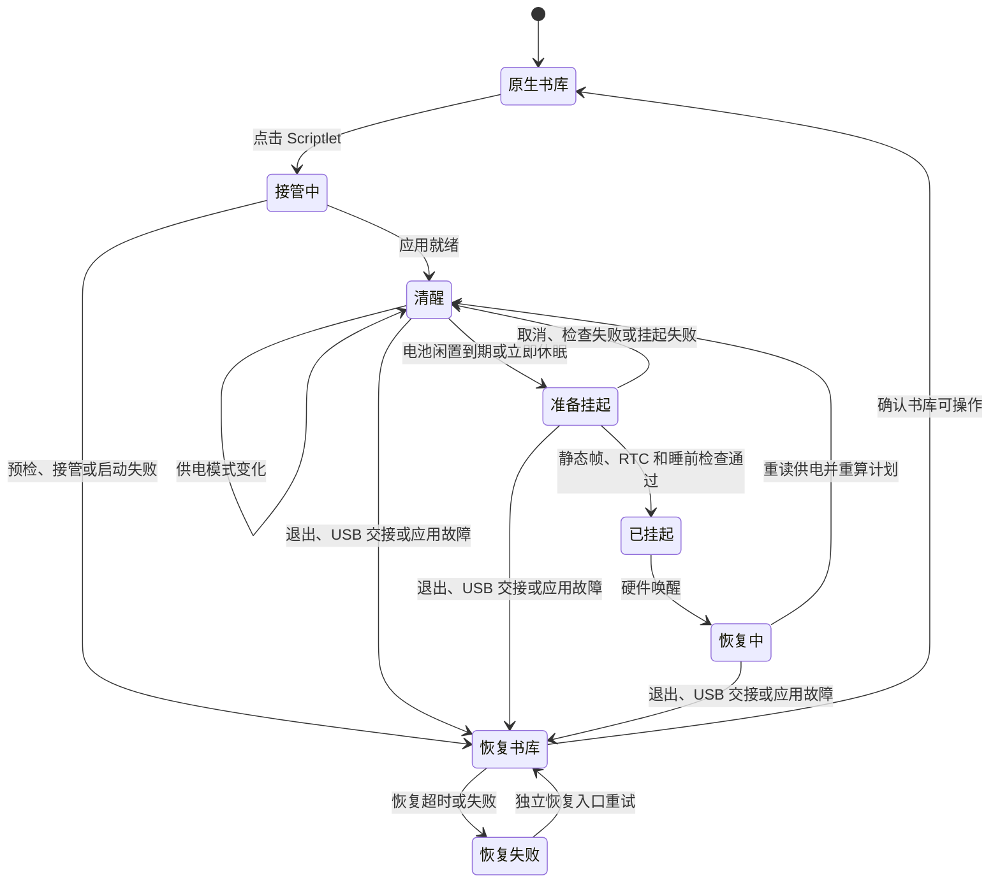

# KPW4 信息面板客户端规格 v0.1

目标设备为 Kindle Paperwhite 第十代（KPW4 / PW4）。从原生书库点击 Scriptlet 进入面板，退出后可继续使用原生阅读器和 KOReader。服务端提供信息页的正文和排版，客户端负责渲染、顶部状态栏、离线缓存与电源调度。睡眠和系统接管能力以当前固件的真机结果为准。

[打开交互状态图](client-state.html) · [图源](client-state.lifecycle.json)

## 1. 状态与转换

启动器管理原生系统的交接及回滚。客户端的事件循环串行处理触摸、供电变化、定时器和任务回调。当前页面、前光、联网任务是独立状态。每次挂起准备和数据请求携带独立代号，过期的回调直接丢弃。

| 状态 | 进入与动作 | 退出条件与去向 |
| --- | --- | --- |
| 原生书库 | 系统处于原生使用状态，或恢复书库已确认成功 | 点击 Scriptlet → 接管中。重复启动由单实例锁拒绝 |
| 接管中 | 独立启动器预检可执行文件、运行目录、权限及当前服务状态。记录会被修改的原值，取得电源设置和屏幕接管权，启动应用并等待就绪。应用初始化配置、缓存、字体和设备接口 | 首帧、输入及退出机制就绪 → 清醒。预检、接管或启动失败、就绪超时 → 恢复书库 |
| 清醒 | 默认 Page 0。读取电量和供电。电池且休眠能力可用时启用闲置期限。墙充时保持运行，按分钟更新可见时钟。供电未知时禁止主动挂起并重查 | 电池闲置到期或点击「立即休眠」→ 准备挂起。插拔墙充在本状态切换模式，拔线后给完整闲置窗口。退出、USB 存储交接或应用故障 → 恢复书库 |
| 准备挂起 | 转 Page 0，停止派发新刷新，处理本轮网络任务的剩余预算，提交待机静态帧并等待面板确认。重读供电和时钟，确认目标有效后设置 RTC，提交挂起 | 刷新确认、RTC 设置及睡前检查均通过 → 调用内核挂起。触摸、插电、自动刷新到期、检查失败或内核挂起未成功 → 撤销本轮并回清醒。退出、USB 交接或应用故障 → 恢复书库 |
| 已挂起 | 内核挂起，应用无法执行。面板保持睡前画面 | RTC、电源键或经真机验证可用的墙充事件触发内核返回 → 恢复中 |
| 恢复中 | 清理本轮遗留闹钟，重新读取供电、时间、电量和联网状态，恢复清醒 UI。唤醒源未知时仍按当前条件重新计算 | 供电和调度已更新，或供电读数超时并按未知处理 → 清醒。发现 USB 存储交接、应用故障或收到退出 → 恢复书库。联网失败保留缓存，按清醒态规则处理 |
| 恢复书库 | 停止并等待应用及其子进程，撤销本程序的 RTC 设置。按接管记录恢复原生服务、电源设置和临时修改，确认书库可操作，再清理会话目录与锁 | 恢复完成 → 原生书库。恢复超时或无法确认完成 → 恢复失败。个别步骤失败时继续可独立执行的清理，记录失败项，保留恢复记录供重试 |
| 恢复失败 | 启动器无法确认书库已恢复，或监督进程异常退出后，由恢复入口读到未完成的接管记录 | 执行独立恢复入口 → 恢复书库，重试剩余步骤。恢复完成前禁止新会话 |

交互图展示主要路径。以下状态图补全恢复书库的分支。挂起系统调用若返回错误，由准备挂起直接回到清醒。

## 2. 挂起控制与事件优先级

- **电源策略只在信息面板会话内生效。** 原生 `powerd` 全程运行。面板接管后才临时抑制原生屏保，并可安排自己的 RTC 唤醒。退出或故障回退时先停止应用的调度，只撤销仍属于本次会话的 RTC 闹钟，把 `preventScreenSaver` 恢复到接管前的值，再交还原生界面。返回书库后由原生 `powerd` 独自管理屏保、休眠和唤醒，面板不保留后台任务或系统启动项。

- 应用持有唯一的闲置截止时间，使用单调时钟。建议默认 **25 秒**。清醒时，Page 0 和 Page 1 的有效触摸统一从输入层重置期限。按钮正常收到事件，环境噪声、渲染和网络回调不延长闲置。清醒时电源键不触发应用睡眠。
- 使用 Slint Kindle 后端的屏幕与触控能力。首版固定上游版本，增加一次性挂起入口或小型补丁，由应用提交明确请求。保持上游自动 `WakeSchedule` 关闭，避免双方各自设 RTC 或写入内核挂起。底层需要提供输入事件、静态帧完成、RTC 设置/清理及挂起结果。上游现行事件循环和 API 的行为以固定版本复核。[事件循环](https://github.com/sverrejb/slint-kindle-backend/blob/main/src/platform.rs) · [调度 API](https://github.com/sverrejb/slint-kindle-backend/blob/main/src/lib.rs)
- 「立即休眠」跳过闲置计时，进入相同的睡前流程。它终止本轮界面的刷新等待，可设置短暂取消窗口，默认不加固定等待。面板完成确认必须有期限；如果底层没有可靠的完成事件，先实测可用的等待策略，超时回清醒并显示失败。
- 睡前的优先级是**退出或 USB 存储交接 → 墙充或有效触摸 → 到期的自动刷新 → 提交挂起**。处理顺序在最终提交前再检查一次，提交窗口尽量短。取消时撤销本轮 RTC、恢复清醒状态栏，保留触摸可操作性。因触摸取消时延长清醒窗口，因墙充取消时切到插电常驻。因刷新到期取消时消费该目标一次，等待受限的拉取流程，再重新准备挂起。
- RTC 写入或挂起失败时回清醒并留可见错误，首版建议 **60 秒**后再允许自动尝试。连续 **3 次**失败时，本会话停用自动挂起，提供单独的手动重试或退出入口。发现 RTC 不可用直接进入可交互降级模式。能识别的未入睡或连续极短返回按挂起失败处理，避免空转。
- 成功恢复后使用新的闲置期限。只有一个设备层写入内核挂起和 RTC。设置闹钟前辨认 RTC 节点并检查已有闹钟，检测到归属不明或冲突时取消本轮挂起。提前唤醒、取消和退出仅清除仍匹配本轮记录的值。保留 `powerd`，原生屏保抑制和前光控制按固件实测启用。

## 3. 刷新计划与时间

| 项目 | v0.1 约定 |
| --- | --- |
| 电池模式 | 默认 30 分钟，可选 15 / 30 / 60 分钟及整点。周期档以启动或修改周期时刻为基准，后续按该基准加整数个周期。整点档取下一个本地整点。随唤醒、前台交互和网络用时保持同一计划基准 |
| 插电常驻 | 使用相同的刷新计划，按分钟刷新可见时钟。Page 1 闲置 60 秒回 Page 0。前光独立调节 |
| 到期与提前唤醒 | 启动尝试拉取一次。若已启用夜间免打扰且处于夜间窗口，启动时只显示缓存，允许手动拉取。RTC 或提前唤醒均先检查是否到期。若清醒期间错过多个计划点，最多尝试一次并推进到未来，手动刷新不重置周期基准 |
| 夜间 | 开启后按设备本地时间暂停 00:00–07:00 的自动拉取与计划唤醒，两种供电模式都适用。若下一次自动刷新落入该时段，把本次推到 07:00，之后回到原计划。保留手动唤醒、立即刷新和前光调节 |
| 时间来源 | 用实际日期时间保存下一次刷新目标，准备挂起前按当前时间换算 RTC 延迟。时区切换或时钟跳变后重算目标。设备时间明显无效时显示提示，暂用相对周期，挂起前仍需确认 RTC 可用 |

若挂起准备期间目标变成已到期，先刷新再尝试挂起。模式切换时保留目标时间并重新检查是否到期。间隔、闲置、请求预算和夜间窗口是配置项，表中值是首版默认值。

## 4. 页面、网络和持久化

- **首版部署范围** 为同一局域网内的 Kindle 和服务端。Kindle 使用可配置的服务端地址拉取页面与图片。域名及 Cloudflare Tunnel 的接入留待后续设计。
- **Page 0 正文** 渲染服务端描述的积木。页面可以全是文字，也可以在任意容器中混排图片和按钮。`column` 纵向排列，`row` 横向分栏。文字样式和按钮动作使用客户端内置预设。客户端优先渲染缓存，首次无缓存时仍可进入设置、立即刷新和退出。
- **Page 0 顶部状态栏** 由客户端固定绘制。清醒时显示设备本地时间、电量、充电状态和当前页面最后更新时间，并保留本地设置入口。供电状态区分电池供电、正在充电和已接电但未充电。
- **Page 0 休眠状态栏** 在挂起前切换成「休眠中 · 更新于 HH:mm」，正文保持最后一帧。唤醒或取消挂起后先恢复清醒状态栏，再按计划判断是否拉取新内容。
- **最后更新时间** 记录当前页面最近一次成功应用新版内容的本地时间。刷新失败或收到 `304 Not Modified` 时继续显示之前的时间。首次无缓存时显示「尚未更新」。
- **Page 1** 提供前光调节、刷新与夜间选项、Wi-Fi 状态及 IP、服务端最近请求结果、立即刷新、重连 Wi-Fi、返回和退出。仅在电池模式且挂起可用时提供「立即休眠」。前光等级以真机读写能力为准，退出时恢复面板接管前的前光值。
- **一次只允许一个拉取任务。** 使用有总时限的后台请求，建议初值 15 秒，涵盖等待 Wi-Fi 就绪和有限重试。手动操作可加入正在执行的请求。重连作用于已保存的网络，成功后发起或合并一次刷新。闲置到期时最多等现有任务用完剩余预算，立即休眠可提前取消或废弃它。所有结果经事件循环提交，挂起或退出时失效的请求结果不能覆盖 UI 或缓存。
- **数据校验后再替换缓存。** 服务端响应包含协议版本和由积木组成的正文。限制响应尺寸、积木数量、容器嵌套深度和文本长度。请求失败、超时或不支持的版本保留上次有效快照。分别记录最近尝试、最近成功拉取和页面最后更新时间。配置与缓存保存在可持久化目录，原子替换；待机帧、锁和运行日志使用会话目录。若 USB 存储不可访问，保留内存视图并停止写入，按交接规则退出。
- **生命周期与恢复。** Scriptlet 拉起脱离原生桌面进程组的启动器。启动器记录已取得的资源，并监听应用退出和可捕获信号。对卡死提供经验证的独立恢复入口，必要时终止本应用的进程组。恢复动作可重复执行，只回滚本应用取得的资源。清理过程中不得因一个动作失败而跳过恢复书库。首版不改充电阈值，也不修改系统启动项。原生服务名、临时目录和 USB 识别方式纳入机型配置，由实测确定。[Scriptlet 文档](https://kindlemodding.org/kindle-dev/scriptlets.html)

## 5. KPW4 真机验收顺序

所有项目待测。记录固件版本、固定的后端版本、供电方式、试验时间和结果。先接通独立恢复手段，再验证屏幕接管。测挂起时拔掉调试用 USB，使用设备日志对照睡前、RTC 和内核返回的时间。

| 顺序 | 验收项目 | 通过条件 | 未通过时 |
| --- | --- | --- | --- |
| 1 | Scriptlet 启动、原生服务、临时目录 | 能记录原值并独立存活，桌面停止后屏幕与触摸归面板。验证目录为可执行的内存文件系统，确认实际服务名 | 保持书库可用，修正启动或运行目录后再接管 |
| 2 | 退出、部分接管失败、应用崩溃及卡死 | 正常与注入失败均能恢复书库、前光、电源设置与触控。独立恢复入口在面板无响应时仍可用。随后打开一本书，再进入并退出 KOReader | 先修复恢复路径，暂缓启用休眠 |
| 3 | `powerd` 和原生行为 | 验证 `preventScreenSaver` 值及恢复，确认原生屏保、清醒电源键、皮套磁感应和 Hibernation 是否触发，验证前光及 Wi-Fi 仍可用 | 根据固件行为调整适配。无法保持屏幕独占时暂停对应模式 |
| 4 | RTC、真实挂起与硬件唤醒 | 确定 RTC 节点及实际内核挂起状态。分别测 RTC、电源键、墙充，验证多轮定时唤醒、提前唤醒清旧闹钟，以及模拟 RTC/挂起失败能回清醒 | RTC 或挂起不可用则停用自动挂起。墙充不能唤醒则等 RTC 或电源键唤醒后切模式 |
| 5 | 画面提交与输入竞争 | 自动及立即休眠都留下正确的静态画面。测试睡前触摸、插电、刷新同时完成，验证取消、首触与下一轮调度 | 修正刷新确认、输入归属和最后一次供电检查 |
| 6 | 墙充与电脑 USB | 墙充不挂起，拔线有完整闲置窗口。USB 存储导出时原生系统接管，配置和缓存仍可读 | 区分不可靠时走保守路径，供电可疑时禁止主动挂起，确认系统接管后退出 |
| 7 | 联网和时间边界 | 记录唤醒后获得 IP 和首次有效响应的耗时。断网、服务端慢响应、重复刷新、夜间起止、整点和时钟跳变均按表执行 | 调整实测预算和重试，保持离线缓存及退出可用 |
| 8 | 电池续航与低电量 | 对照相同前光和刷新计划下的清醒与定时挂起耗电。确认低电下原生保护仍生效 | 以实测确定前光及刷新默认值。原生低电保护异常时禁用电池自动模式 |

上游列出 PW4 的后端兼容性。其他 PW4 项目复现过 RTC 挂起与 Wi-Fi 恢复，可作对照。上表以本机匹配固件与应用版本的结果判定。[上游设备列表](https://github.com/sverrejb/slint-kindle-backend#tested-devices) · [PW4 实测记录](https://github.com/estcarisimo/paperwhite-weather/blob/main/docs/DEVICE.md#power-measured-and-verified-on-2026-09-19)

